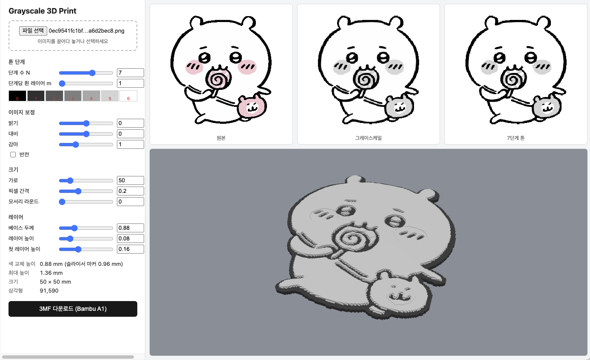
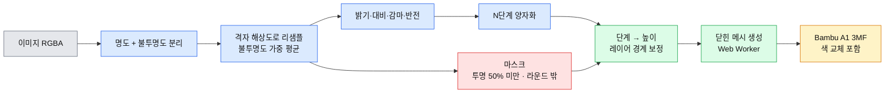

# grayscale-3d-print

흑백(그레이스케일) 그림을 **검정·흰색 필라멘트 2가지와 레이어 두께**로 표현하는 3D 프린트 모델을 만드는 웹 애플리케이션입니다. 이미지를 올리면 명도를 N단계로 나누고, 단계마다 흰 레이어를 쌓아 Bambu Studio에서 바로 열리는 3MF 파일을 만들어 줍니다.

**사용해 보기:** https://gyuha.github.io/grayscale-3d-print/



## 원리

검정 필라멘트로 바닥(베이스)을 깔고, 한 번만 흰색으로 교체해서 그 위에 흰 레이어를 쌓습니다. 흰 필라멘트는 얇으면 아래의 검정이 비쳐 어둡게 보이고, 두꺼우면 하얗게 보입니다. 그래서 **어두운 곳은 낮게(흰 레이어 적게), 밝은 곳은 높게(흰 레이어 많이)** 만들면 레이어 두께만으로 회색 톤이 생깁니다. 색 교체는 프린트 중 단 한 번이라 AMS 없이도 출력할 수 있습니다.

기본값(N=7, 단계당 흰 레이어 1장, 레이어 0.08mm) 기준 높이 구성은 다음과 같습니다.

| 톤 단계 | 흰 레이어 수 | 윗면 높이 | 보이는 색 |
|---|---|---|---|
| 0 (가장 어두움) | 0 | 0.88 mm | 검정 |
| 1 | 1 | 0.96 mm | 진한 회색 |
| … | … | … | … |
| 6 (가장 밝음) | 6 | 1.36 mm | 흰색에 가까움 |

```
0 ─ 0.88 mm : 검정 베이스 (첫 레이어 0.16 + 0.08 × 9)
        ↓ 0.88 mm에서 흰색으로 교체
0.88 ─ 1.36 mm : 흰 레이어 0~6장 → 회색 톤
```

## 기능

- **이미지 업로드**: 파일 선택 또는 끌어다 놓기 (PNG, JPG, WebP 등 브라우저가 읽는 형식)
- **톤 단계**: 단계 수 N(2~10)과 단계당 흰 레이어 수 m을 조절합니다. 단계 k의 높이는 `베이스 + k × m × 레이어 높이`입니다.
- **이미지 보정**: 밝기, 대비, 감마, 반전
- **크기**: 가로 폭(mm, 세로는 비율 유지), 픽셀 간격(0.1~0.4mm, 기본 0.2mm), 모서리 라운드(mm)
- **레이어**: 베이스 두께, 레이어 높이, 첫 레이어 높이. 모든 높이는 슬라이서 레이어 경계에 맞춰 자동 보정됩니다.
- **투명 배경 제외**: PNG의 투명한 부분(평균 불투명도 50% 미만)은 출력하지 않습니다. 캐릭터 모양 그대로 잘린 모델이 됩니다.
- **미리보기**: 원본 / 그레이스케일 / N단계 톤 2D 비교와 회전 가능한 3D 부조
- **3MF 내보내기**: Bambu Lab A1(0.4 노즐, 0.08mm 레이어, 100% 채움) 프로젝트 파일. 검정·흰색 필라멘트와 색 교체 위치가 미리 들어 있습니다.

모든 처리는 브라우저 안에서 일어납니다. 이미지는 서버로 전송되지 않습니다.

## 사용 방법

이미지를 올리고 단계와 크기를 조절한 뒤 3MF를 받아 Bambu Studio에서 슬라이스하고 출력합니다.

```
이미지 업로드 → 단계·보정·크기 조절 → 3MF 다운로드 → Bambu Studio에서 열기·슬라이스 → 출력 (색 교체 1회)
```

1. 이미지를 올립니다. 대비가 뚜렷한 그림이나 선화가 잘 나옵니다.
2. 오른쪽 **N단계 톤** 미리보기를 보며 단계 수와 밝기·대비·감마를 조절합니다.
3. **3MF 다운로드 (Bambu A1)** 를 눌러 파일을 받습니다.
4. Bambu Studio에서 엽니다. 필라멘트 1번은 검정, 2번은 흰색입니다.
5. 슬라이스하면 레이어 슬라이더에 **색 교체 마커**가 보입니다. 화면 정보 패널의 "슬라이서 마커" 높이(기본 0.96mm)와 같은지 확인합니다.
6. 출력합니다. AMS가 없으면 마커 위치에서 프린터가 멈추고 필라멘트 교체를 요청합니다.

> 정보 패널의 **색 교체 높이(0.88mm)** 는 검정이 끝나는 높이이고, **슬라이서 마커(0.96mm)** 는 첫 흰 레이어의 높이입니다. 슬라이서는 마커가 붙은 레이어부터 새 색으로 출력하기 때문에 두 값이 한 레이어 차이 납니다.

## 팁과 한계

- 화면의 회색은 검정→흰색 선형 보간일 뿐, 실제 출력 색은 흰 필라멘트의 투광성에 따라 달라집니다. 처음에는 단계 수를 바꿔 가며 작은 샘플을 출력해 보세요.
- 3D 미리보기는 베이스를 검정, 흰 레이어를 흰색 두 가지로만 칠합니다. 흰 레이어 사이의 톤 차이는 높이(음영)로만 보입니다.
- 모서리 라운드와 투명 배경 윤곽은 픽셀 간격(기본 0.2mm) 크기의 계단 모양입니다. 노즐 폭(0.4mm)보다 작아서 출력물에서는 거의 드러나지 않습니다.
- 1~2픽셀 크기로 떨어진 점은 아주 작은 조각이 되어 출력되지 않거나 떨어질 수 있습니다.
- 3MF는 Bambu Lab A1 설정에 맞춰져 있습니다. 다른 프린터는 Bambu Studio에서 프린터를 바꾸고, 레이어 높이를 앱과 같게 맞춰야 색 교체 위치가 어긋나지 않습니다.

## 개발

Vite + React + TypeScript, three.js(3D 미리보기), fflate(3MF 압축)를 사용합니다. 메시 생성은 Web Worker에서 실행됩니다.

```bash
npm install
npm run dev        # 개발 서버
npm test           # 단위 테스트 (Vitest)
npm run build      # 정적 빌드 → dist/
npm run sample     # 7단계 그라데이션 샘플 → samples/sample.3mf
```

[Task](https://taskfile.dev)를 쓴다면 같은 작업을 `task dev`, `task test`, `task build`, `task preview`, `task sample`로 실행할 수 있습니다. `task dev`와 `task preview`는 `0.0.0.0`에 바인딩해 다른 기기에서도 접속할 수 있습니다(`task dev PORT=5179`처럼 포트 지정 가능).

### 처리 과정

이미지는 모델 격자 해상도로 줄인 뒤 명도를 N단계로 나누고, 단계를 높이로 바꿔 닫힌 입체 메시를 만든 다음 Bambu 3MF로 묶습니다. 투명 픽셀과 라운드 모서리 밖의 칸은 높이 0(빈 칸)으로 처리되어 메시에서 빠집니다.



### 코드 구조

| 경로 | 역할 |
|---|---|
| `src/core/image.ts` | 명도·불투명도 추출, 보정, N단계 양자화 |
| `src/core/heights.ts` | 레이어 경계 보정, 단계 높이, 리샘플, 라운드 마스크 |
| `src/core/pipeline.ts` | 이미지 → 단계·높이·마스크 (위 과정을 묶음) |
| `src/core/mesh.ts` | 높이맵 → 닫힌 입체 메시 (같은 높이 영역 병합) |
| `src/core/mesh.worker.ts` | 메시 생성 Web Worker |
| `src/core/threemf.ts` | Bambu Studio 프로젝트 3MF 작성 |
| `src/core/bambu-a1-project-settings.json` | A1 프린트 설정 템플릿 (검정·흰색 2필라멘트) |
| `src/ui/` | 미리보기 픽셀 변환, 3D 뷰어, 이미지 디코딩 |
| `src/App.tsx` | 화면 구성 |

## 배포

`main` 브랜치에 푸시하면 GitHub Actions(`.github/workflows/deploy.yml`)가 테스트와 빌드를 거쳐 GitHub Pages에 배포합니다. 저장소의 **Settings → Pages → Source**를 **GitHub Actions**로 설정해 두어야 합니다.

```
main 푸시 → npm ci → npm test → npm run build → Pages 배포
                         ↓ 실패
                     배포 중단
```
